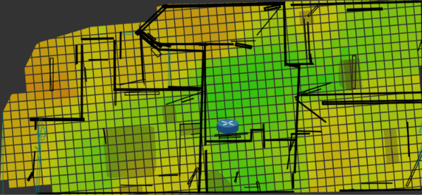
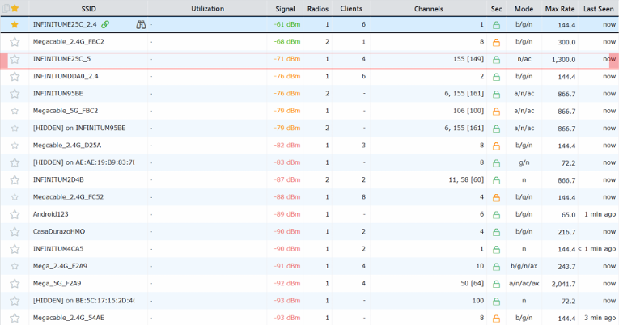
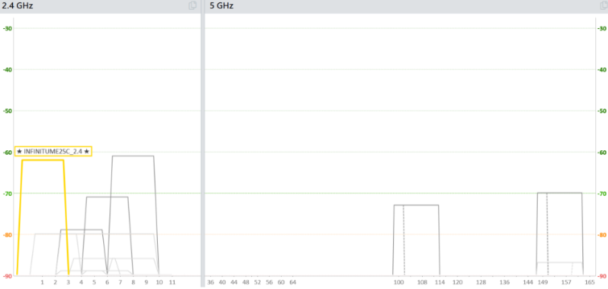
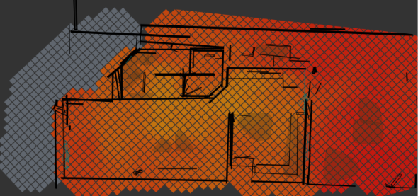
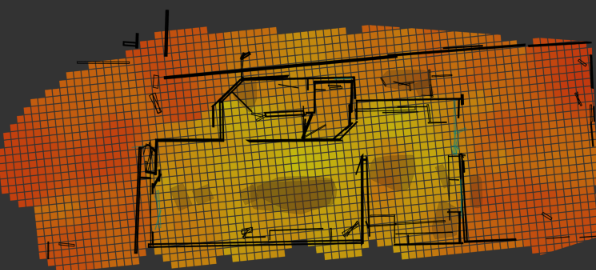

# Estudio de Sitio WLAN y Análisis de Cobertura

*Materia: Comunicación de Datos II (4to semestre) · Fecha: 7 de mayo de 2026 · Equipo 2: Ibarra Padilla Sebastian, Martínez Ruiz Josué Ignacio, Ortega Molina Marco Sebastian, Ochoa Camargo Victor Miguel*

## 1. Descripción

Estudio de sitio inalámbrico (site survey) en una casa de dos plantas para ver cómo se comporta una red WLAN doméstica real (red de prueba: **INFINITUME25C**, en 2.4 y 5 GHz). Analizamos redes vecinas, congestión de canales, clientes, seguridad y cobertura. Herramientas: **InSSIDer**, el panel del router y **Ubiquiti WiFiman** con LiDAR para los mapas de calor.

## 2. Requerimientos del cliente

- Detectar las redes WLAN del entorno y sus características.
- Analizar la congestión de canales en 2.4 GHz y 5 GHz.
- Identificar clientes conectados y revisar la seguridad de las redes.
- Mapear la cobertura en planta alta y baja, en ambas bandas.
- Concluir cómo influyen las barreras arquitectónicas y la frecuencia.

## 3. ¿Cómo se diseñó la solución?

Dos fases:

1. **Análisis de redes (InSSIDer):** laptop como dispositivo de captura, midiendo a distancias crecientes del módem (< 1 m, 2 m, 5 m dentro de un cuarto y 10 m en planta baja con losa de concreto).
2. **Mapeo de cobertura (WiFiman + LiDAR):** el LiDAR captura paredes, puertas y muebles para generar 4 mapas de calor (2 plantas × 2 bandas).

Medimos ambas bandas en los mismos puntos para comparar la teoría: 2.4 GHz tiene más alcance y penetra mejor; 5 GHz es más rápida pero se atenúa más.

## 4. ¿Cómo se implementó la solución?

1. **Detección:** más de 15 redes, de Megacable y Telmex principalmente, con 3 redes ocultas.
2. **Señal por distancia:**

   | Punto | 2.4 GHz | 5 GHz |
   |---|---|---|
   | < 1 m (planta alta) | -30 dBm | -21 dBm |
   | 2 m (planta alta) | -43 dBm | -45 dBm |
   | 5 m, dentro de un cuarto | -59 dBm | -66 dBm |
   | 10 m, planta baja | -66 dBm | -82 dBm |

3. **Prueba con microondas:** su magnetrón opera a ~2450 MHz y la red estaba en el canal 1 (2412 MHz); no hubo cambios, ni siquiera al pasar al canal 11. Probablemente por el blindaje del horno, y porque la interferencia sube el ruido más que bajar la señal.
4. **Canales:** en 2.4 GHz solo el 1, 6 y 11 no se solapan; nuestra red está en el canal 1, un extremo poco congestionado. En 5 GHz casi no hay redes; la nuestra usa el canal 155 [149].
5. **Clientes:** 17 dispositivos registrados (11 en 2.4 GHz, 6 en 5 GHz), casi todos por DHCP.
6. **Seguridad:** todas las redes tienen cifrado, predomina WPA2-Personal. Las Megacable usan modo mixto WPA/WPA2 (permite TKIP, inseguro) y ninguna usa WPA3.
7. **Detalle desde planta baja:** 2.4 GHz a -62 dBm (WiFi 4, 144.4 Mbps teóricos) y 5 GHz a -71 dBm (WiFi 5, 80 MHz, 1300 Mbps teóricos, señal más inestable).

**Problema:** la prueba del microondas no dio el efecto esperado; lo documentamos y explicamos en lugar de forzar el resultado.

## 5. ¿Cuál fue el resultado?

Se cumplieron los requerimientos y obtuvimos los cuatro mapas de calor.

- **Planta alta, 5 GHz:** señal muy fuerte (-30 a -50 dBm) en el cuarto del módem, pero cae a -60/-80 dBm en cuartos adyacentes.
- **Planta alta, 2.4 GHz:** cobertura casi total (-35 a -55 dBm).
- **Planta baja, 5 GHz:** casi todo en rojo (-70 a -80 dBm); prácticamente inutilizable.
- **Planta baja, 2.4 GHz:** zona central entre -60 y -70 dBm, suficiente para dispositivos cotidianos e IoT.

**Lo que aprendí:** la teoría se confirma en un entorno real y los materiales pesan tanto como la distancia: la losa de concreto atenuó 5 GHz mucho más que las paredes (16 dB de diferencia entre bandas a 10 m, contra 7 dB dentro de un cuarto). También aprendí a usar herramientas de site survey y a leer mapas de calor. Como mejora, agregaríamos un segundo punto de acceso en planta baja, y usaríamos WPA3 en lugar del modo mixto.
